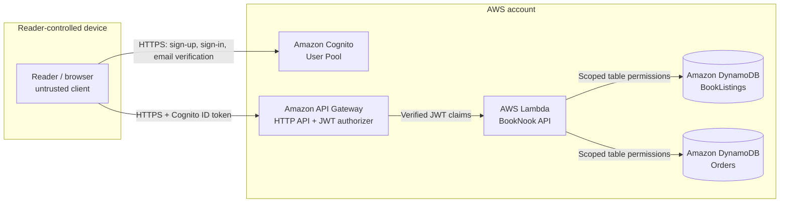

# BookNook architecture and threat-modeling notes

## System overview

BookNook is a small book marketplace prototype. Members browse listings, post books for sale, and place a demo order. The checkout records an order and marks a listing sold atomically; it does **not** take payment, calculate shipping, or issue invoices.

The browser is served locally for this prototype. `web/config.js` points it at the deployed API and Cognito pool when configured. There is intentionally no object-storage bucket in this architecture.

## Trust boundaries and data

| Boundary | Data crossing it | Main controls |
|---|---|---|
| Reader device → Cognito | Email, password, verification code | Cognito-managed authentication; browser never receives an app-client secret |
| Reader device → API Gateway | Listing and order requests, Cognito ID token | HTTPS; API Gateway validates issuer and audience on every route |
| API Gateway → Lambda | Request body, route parameters, verified JWT claims | Lambda takes member ID from the verified `sub` claim, not from caller input |
| Lambda → DynamoDB | Listings and demo-order records | Function role limited to the two application tables; transactional checkout |

Sensitive or important data: member identifiers and email addresses, listing descriptions, prices, order history, and authentication tokens in the browser session. The API does not store passwords or payment-card data.

## Core flows

1. **Register and sign in:** browser calls Cognito User Pool APIs; the API client sends its Cognito ID token to the API.
2. **Browse:** authenticated `GET /books` queries the `LISTED` index.
3. **Sell:** authenticated `POST /books` validates the request and sets `sellerId` from the JWT subject.
4. **Buy:** authenticated `POST /books/{bookId}/checkout` atomically changes a listed book to sold and creates an order. DynamoDB conditions prevent buying one's own book or placing multiple successful orders for the same listing.
5. **Account views:** `GET /me/listings` and `GET /me/orders` use the authenticated member ID as the index partition key.

## Assets and abuse cases to explore

- **Account takeover:** stolen password, weak recovery flow, token theft, and prolonged browser sessions.
- **Broken object-level authorization:** changing a book or member identifier to access another reader's records.
- **Marketplace integrity:** price tampering, duplicate checkout, buying one's own listing, invalid listing content, and automated listing abuse.
- **Sensitive data exposure:** excessive API responses, logs containing tokens, or overly broad database access.
- **Availability and cost:** unbounded traffic, repeated searches, or high-volume account creation.
- **Supply-chain and operator risk:** compromised browser code, Lambda code, or deployment credentials.
- **Trust in the user and seller:** misleading descriptions and off-platform communication are not addressed by this prototype.

## Deliberate prototype limits

- Checkout records a `PLACED` order only. It does not integrate a payment processor, handle refunds, provide shipping, or issue receipts/invoices.
- The browser's demo mode uses local storage and simulated sign-in. It is for UI exploration only and is not an authentication or persistence control.
- The browser assets are served locally in this sample; production hosting, custom domain, TLS configuration, and content security policy need a deliberate deployment design.
- Rate limiting, moderation, audit logging, alarms, and operational response procedures are not configured.
- No S3 bucket or other invoice storage is part of the initial design.
