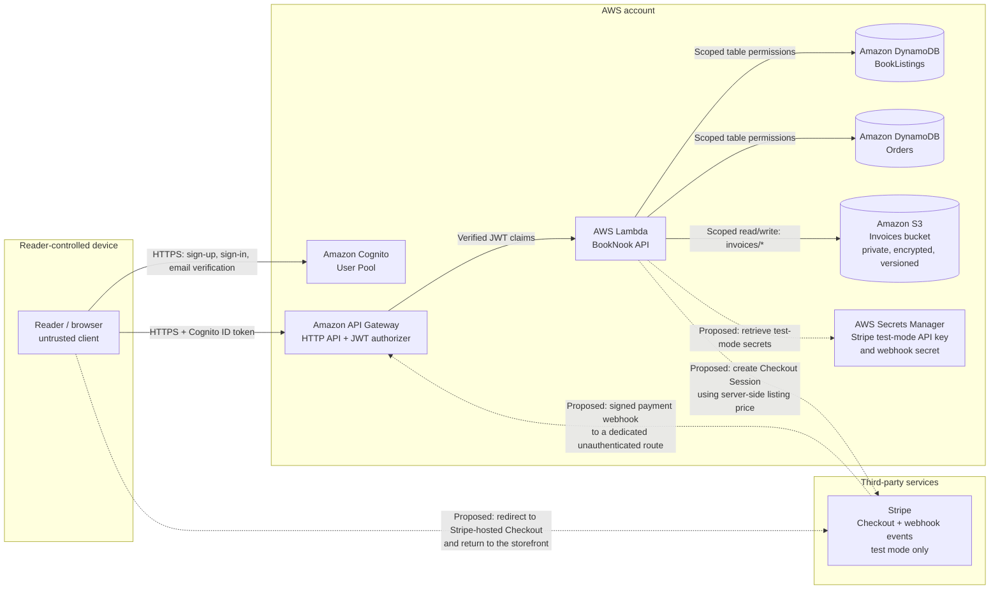

# BookNook architecture and threat-modeling notes

## System overview

BookNook is a small book marketplace prototype. Members browse listings, post books for sale, and place a demo order. The implemented checkout records an order and marks a listing sold atomically; it does **not** take payment, calculate shipping, or issue invoices. The Stripe flow below is a proposed test-mode extension for threat-modeling exercises and is not implemented.

Solid lines show implemented components and infrastructure permissions; dashed lines show the proposed Stripe test-mode extension. The Lambda has scoped S3 access for invoice objects, but invoice generation, upload, download, and API routes are not implemented. The browser is served locally for this prototype. `web/config.js` points it at the deployed API and Cognito pool when configured.

## Trust boundaries and data

| Boundary | Data crossing it | Main controls |
|---|---|---|
| Reader device → Cognito | Email, password, verification code | Cognito-managed authentication; browser never receives an app-client secret |
| Reader device → API Gateway | Listing and order requests, Cognito ID token | HTTPS; API Gateway validates issuer and audience on every route |
| API Gateway → Lambda | Request body, route parameters, verified JWT claims | Lambda takes member ID from the verified `sub` claim, not from caller input |
| Lambda → DynamoDB | Listings and demo-order records | Function role limited to the two application tables; transactional checkout |
| Lambda → S3 invoice bucket | Invoice objects under the `invoices/` prefix | Lambda role can read/write only that prefix; S3 blocks public access, enforces TLS, encrypts objects at rest, and versions objects |
| BookNook backend → Stripe (proposed) | Checkout Session request with server-selected amount, currency, and opaque order reference; signed webhook events back to BookNook | Stripe test mode; keep API and webhook secrets server-side; verify webhook signatures; treat browser redirects as untrusted |
| Reader device ↔ Stripe (proposed) | Redirect to hosted Checkout and return URL; card details are entered directly on Stripe | HTTPS; do not collect or store card details in BookNook; a browser return is not proof of payment |

Sensitive or important data: member identifiers and email addresses, listing descriptions, prices, order history, invoice files, and authentication tokens in the browser session. The implemented API does not store passwords or payment-card data. Invoice storage is provisioned, but the application does not currently create or serve invoices. The proposed Stripe integration adds API and webhook secrets, and payment identifiers/statuses; secrets must not be sent to the browser or written to logs.

## Core flows

1. **Register and sign in:** browser calls Cognito User Pool APIs; the API client sends its Cognito ID token to the API.
2. **Browse:** authenticated `GET /books` queries the `LISTED` index.
3. **Sell:** authenticated `POST /books` validates the request and sets `sellerId` from the JWT subject.
4. **Buy:** authenticated `POST /books/{bookId}/checkout` atomically changes a listed book to sold and creates an order. DynamoDB conditions prevent buying one's own book or placing multiple successful orders for the same listing.
5. **Account views:** `GET /me/listings` and `GET /me/orders` use the authenticated member ID as the index partition key.
6. **Proposed payment test flow:** the authenticated backend would validate the listing and derive the amount from its stored price, create a Stripe test-mode Checkout Session, and return only the hosted Checkout URL to the browser. Stripe would send a signed event to a dedicated webhook route; the backend would verify the signature and process the event idempotently before marking the order paid. A success redirect alone must never mark an order paid. This flow is not implemented.

## Assets and abuse cases to explore

- **Account takeover:** stolen password, weak recovery flow, token theft, and prolonged browser sessions.
- **Broken object-level authorization:** changing a book or member identifier to access another reader's records.
- **Marketplace integrity:** price tampering, duplicate checkout, buying one's own listing, invalid listing content, and automated listing abuse.
- **Payment integrity (proposed):** forged or replayed webhook events, duplicate event processing, trusting a client-supplied price or success redirect, mismatched order references, stale Checkout Sessions, and test/live mode or key confusion.
- **Third-party dependency (proposed):** Stripe API outage or compromise, unexpected webhook payloads, exposure or rotation of API/webhook secrets, and accidental use of live credentials during testing.
- **Sensitive data exposure:** excessive API responses, logs containing tokens, or overly broad database access.
- **Availability and cost:** unbounded traffic, repeated searches, or high-volume account creation.
- **Supply-chain and operator risk:** compromised browser code, Lambda code, or deployment credentials.
- **Trust in the user and seller:** misleading descriptions and off-platform communication are not addressed by this prototype.

## Deliberate prototype limits

- Checkout records a `PLACED` order only. It does not integrate a payment processor, handle refunds, provide shipping, or issue receipts/invoices.
- The private, encrypted, versioned S3 invoice bucket is provisioned and the API Lambda receives its bucket name plus read/write permission limited to the `invoices/` prefix. Invoice objects are not currently generated, uploaded, or served; no invoice API route exists.
- The Stripe boundary and payment flow in this document are a test-mode design for threat modeling only; there is no Stripe SDK, credential, API route, or live payment integration in the app.
- A future webhook endpoint must be exempted from the API's default Cognito JWT authorizer and instead authenticate events using Stripe signature verification. Do not disable authorization on existing member routes.
- The browser's demo mode uses local storage and simulated sign-in. It is for UI exploration only and is not an authentication or persistence control.
- The browser assets are served locally in this sample; production hosting, custom domain, TLS configuration, and content security policy need a deliberate deployment design.
- Rate limiting, moderation, audit logging, alarms, and operational response procedures are not configured.
